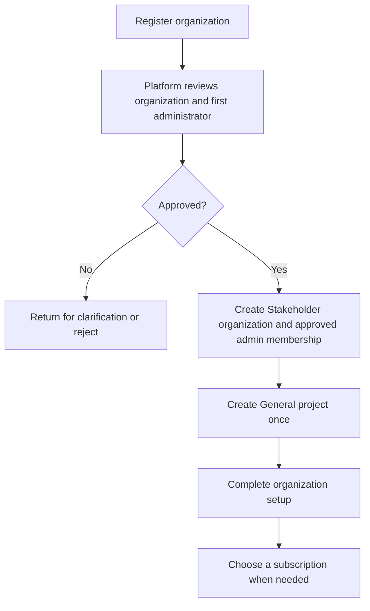
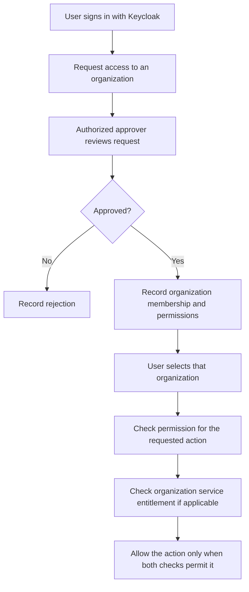
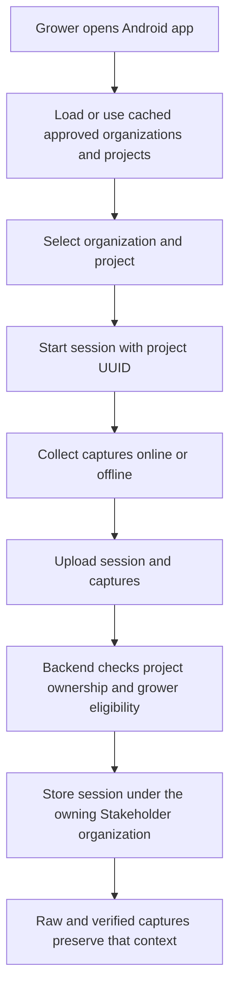

# Organization access, subscriptions and project-based collection

* Status: proposed
* Deciders: To be confirmed with the Stakeholder, identity/admin, Android, Field Data and SaaS maintainers.
* Date: 2026-11-23

Requested by Sebastian Gaertner. Related work: [admin integration #1314](https://github.com/Greenstand/treetracker-admin-client/issues/1314) and [remaining NDM work #1316](https://github.com/Greenstand/treetracker-admin-client/issues/1316).

> **This is the proposed design, not a description of a completed rollout.** The tables below distinguish existing behavior from changes still needed. Free/trial allowances and several approval rules remain open.

## Context and Problem Statement

“Organization binding” currently describes several different things. An admin-panel user requests access, a grower joins an organization, a QR code opens the Android app, and Stripe links a subscription to an organization. We need to connect these flows without treating them as the same relationship.

The **new domain model (NDM)** identifies an organization through its **Stakeholder UUID**. Older integrations still use a numeric organization ID or an organization name. A **session** is one period of field collection; its captures must keep the organization and project they were collected for, even if the grower moves to another organization at a later stage.

### Four separate questions

| Concept | Question it answers | Proposed source |
| --- | --- | --- |
| Login | Who is this person? | Keycloak |
| Membership and permissions | Which organizations can they work with, and what can they do? | Organization-scoped domain memberships |
| Subscription | Which services and limits has the organization purchased? | Stripe, linked to the Stakeholder UUID |
| Data ownership | Which organization and project was this session collected for? | The session's project and its owning Stakeholder organization |

**Payment does not make someone an administrator. A QR code does not grant admin access. A grower's current organization does not determine ownership of historical captures.**

## Decision Drivers

* Let a grower work for several organizations and projects with one grower account.
* Keep login access, permissions, billing and data ownership separate.
* Make organization setup simple, including a usable first project.
* Support offline collection and older app versions during migration.
* Preserve historical ownership and record administrative corrections.

## Considered Options

| Option | Benefit | Problem |
| --- | --- | --- |
| 1. Use one organization attribute for everything | Smallest change to existing clients | Cannot represent several memberships safely; moving a person can change the meaning of old data |
| 2. Assign sessions only to organizations | Supports collection for several organizations | Does not identify which project or project species list applies |
| **3. Separate memberships and billing; assign new sessions to projects** | Explicit permissions and stable collection ownership | Requires coordinated Android and backend changes |

## Decision Outcome

**Proposed choice: Option 3**, with a default project and a staged migration for older clients.

### 1. Starting an organization

Allow an organization to register and complete setup before buying a subscription. Platform approval establishes its first administrator. Approved setup creates one **General** project so the organization does not need to design a project structure immediately.

The General project:

* Belongs to the organization's Stakeholder UUID and counts toward its project quota.
* Is created only once, including when setup is retried.
* Can be renamed without changing its UUID.
* Starts with an empty species selection, like other new projects. An authorized user can allocate species or explicitly choose organization/default inheritance.

Creating a project does not itself authorize collection under a free plan. **Free/trial service access and quotas still need a policy decision. (3 months trial up to 500 captures is proposed here)** Replacing or archiving the default project also needs an agreed rule; it must not change historical session references.

### 2. Giving people admin-panel access

There are two different approval paths:

| Request | Proposed outcome |
| --- | --- |
| First administrator for a new organization | Platform-approved administrator membership, after organization/ownership review |
| Additional user joining an existing organization | Approved membership with explicit permissions, such as verification, project management or species management |

An approved organization administrator can invite and manage later members. We still need to decide whether that administrator can also approve ordinary binding requests, or whether platform approval remains required.

Keycloak remains responsible for login. Domain membership records the organization and permissions; Keycloak roles or claims can reflect that membership. One mutable `organization_id` claim must not be the only record of several memberships.

The existing `org-admin-saas` role is a compatibility mechanism. In the target design, administration is scoped to a particular organization. Being an administrator of organization A must not make someone an administrator of organization B. Billing management may need its own permission.

### 3. Keeping subscriptions separate

A subscription belongs to the organization, not to the email address of one administrator. Stripe metadata should link it to the Stakeholder UUID. Numeric IDs may remain as explicit compatibility mappings during migration.

| Change | What it may affect | What it must preserve |
| --- | --- | --- |
| Upgrade or downgrade | Agreed service limits and features | Memberships and existing data ownership |
| Payment failure or cancellation | Agreed restrictions or grace period | Login identity, memberships and historical sessions/captures |
| New organization administrator | Who can manage the organization or billing | The organization's subscription identity |

The backend must enforce the agreed service policy. A plan label, usage warning or `subscriber_*` role alone is insufficient. Exact free access, trial duration, grace periods and read-only restrictions remain open decisions.

### 4. Growers, organizations and projects

A grower account is distinct from an admin-panel login. A grower may belong to several organizations and participate in several projects. Each project belongs to exactly one Stakeholder organization.

This is a relationship diagram, not a proposal to rename existing tables. The existing `treetracker.grower_account_org` relationship already supports several organization associations; project enrollment uses the proposed `stakeholder.project_grower` relationship.

**Example:** Asha works on ESEA's nursery project on Monday and another organization's restoration project on Tuesday. She keeps one grower account. The two sessions belong to their respective projects and organizations.

A grower's home/primary organization may remain useful for contact or reporting. Changing it must not move Monday's captures to Tuesday's organization.

### 5. Routing sessions and captures

After Android and the upload API support this design, every new session starts with one permitted project UUID. The backend derives the owning Stakeholder organization from that project and checks the grower's eligibility. Conflicting organization/project information must be rejected rather than guessed.

Android should receive only that grower's available organizations/projects, not the global project catalogue. If there is one permitted/default project, it can be selected automatically with a visible indication.

* Switching collection project starts a new session.
* Captures derive their project/organization context through the session; every table does not need another copied project field.
* Upload retries must not overwrite an audited administrator correction.
* Correcting a session requires the real actor, time, reason and previous/new allocation. Already verified captures, matching events, exports and usage must be reconciled consistently.
* Revocation while a device was offline needs an explicit policy. The server must not silently reroute those captures elsewhere.

### 6. QR codes and older clients

The Share App QR identifies an invitation or collection context for an organization, optionally a project. It does not create admin permissions. The server resolves the invitation and applies the agreed membership rules.

Move toward Stakeholder UUIDs or server-resolved invitation tokens while retaining numeric `org_id` compatibility for existing Android/install-referrer links. Renaming the URL parameter alone does not migrate the flow.

Require project UUIDs only after both Android and the upload API support them. For older uploads:

| Available information | Proposed handling |
| --- | --- |
| Known organization and an explicitly configured default project | A controlled migration may allocate the session to that project and record how it was assigned |
| Missing or ambiguous organization/project | Keep the session for explicit allocation; do not invent ownership |
| Grower belongs to several projects | Do not choose an arbitrary project from their memberships |

Preserve existing UUIDs and historical references. Numeric mappings should resolve to `stakeholder.stakeholder.id`; they do not justify new ownership writes to `public.entity`.

## What exists today and what still needs work

| Area | Current evidence | Remaining change |
| --- | --- | --- |
| Admin binding | Approval sets numeric Keycloak `organization_id`, grants `org` and clears the request. A second organization request is blocked for an already-bound login | Audited NDM memberships, multiple approved admin memberships and explicit first-admin onboarding |
| Member permissions | The integration treats `org-admin-saas` as admin; ordinary `org` members default to verification unless scoped grants override it | Agree and implement the full membership-scoped authorization model |
| Billing | Tier display, hosted billing and usage warnings exist in the integration | Define and enforce free/trial/paid access and quota policies |
| Grower memberships | Existing NDM association supports several organizations | Complete the grower enrollment and Android discovery experience |
| Projects | Proposed project schema and admin assignment/correction workflows exist | Automatic General-project creation and agreed default replacement rules |
| Session uploads | Android sends an organization string; the current Field Data POST schema does not accept a project UUID | Versioned project selection/upload and safe older-client handling |
| QR invitations | Current links forward `org_id` and `org_name` into Android | Stakeholder-based invitation resolution and membership handling |

## Decisions still needed before acceptance

| Topic | Question to settle |
| --- | --- |
| Free/trial access | What may an unsubscribed organization do, for how long and within which limits? |
| Payment and quota changes | What is restricted, and what happens to data already collected offline? |
| Approvals and recovery | Who verifies the first administrator, approves later members and recovers lost administration access? |
| Invitations | How do invitation acceptance, expiry and project restrictions work? |
| Android identity and offline use | How are memberships/projects discovered, and how are collectors recording for another grower handled? |
| Default projects and old data | How is a default replaced, and which legacy sessions may be assigned automatically? |
| Allocation corrections | Who may move sessions across organizations, and how are processed records reconciled? |

## Consequences

**Benefits:** clearer permissions, one grower identity across organizations, stable historical ownership and a simple first project for new organizations.

**Costs:** coordinated changes across Android, Stakeholder, identity/admin and Field Data; offline membership handling; and a staged migration for older clients. Existing UI or schema PRs alone do not complete this design.

## Links and supporting evidence

### Existing decisions and use cases

* [0013: Keycloak](0013-keycloak.md) and [0014: permission organization](0014-treetracker-permission-organization.md). This proposal refines membership and ownership; it does not unilaterally supersede those proposals.
* [Admin binding scenario #1266](https://github.com/Greenstand/treetracker-admin-client/issues/1266): an admin-panel user requests membership and receives Verify access after approval.
* [Subscription scenario #1261](https://github.com/Greenstand/treetracker-admin-client/issues/1261): an existing organization upgrades to premium.
* [Accepted session-organization bridge ADR, March 2022](https://github.com/Greenstand/treetracker-field-data/blob/main/docs/adr/0001-organization-by-session-bridge.md): explicitly anticipates growers collecting for several organizations. It describes a historical bridge, not a completed current rollout.
* [Grower organization association](https://github.com/Greenstand/treetracker-api/blob/main/database/migrations/sqls/20220321204145-grower-account-organization-up.sql).
* [Android SessionRequest](https://github.com/Greenstand/treetracker-android/blob/master/app/src/main/java/org/greenstand/android/TreeTracker/api/models/requests/SessionRequest.kt) and [Field Data session schema](https://github.com/Greenstand/treetracker-field-data/blob/main/server/handlers/sessionHandler/schemas.js).

### Related implementation proposals

* [Admin client #1315](https://github.com/Greenstand/treetracker-admin-client/pull/1315) and [admin API #699](https://github.com/Greenstand/treetracker-admin-api/pull/699).
* [Stakeholder projects and membership #49](https://github.com/Greenstand/treetracker-stakeholder-api/pull/49).
* [Field Data session project #121](https://github.com/Greenstand/treetracker-field-data/pull/121) and [correction audit #122](https://github.com/Greenstand/treetracker-field-data/pull/122).
* [Grower transfer history #165](https://github.com/Greenstand/treetracker-api/pull/165).
