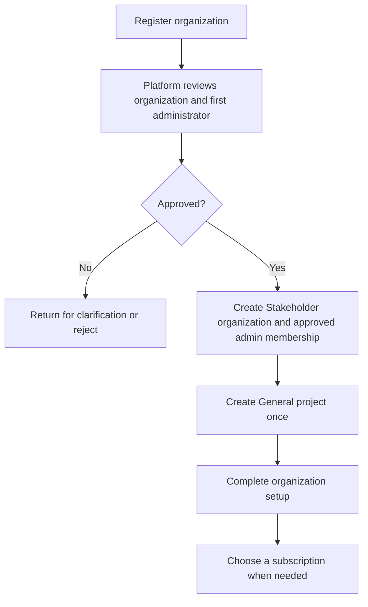
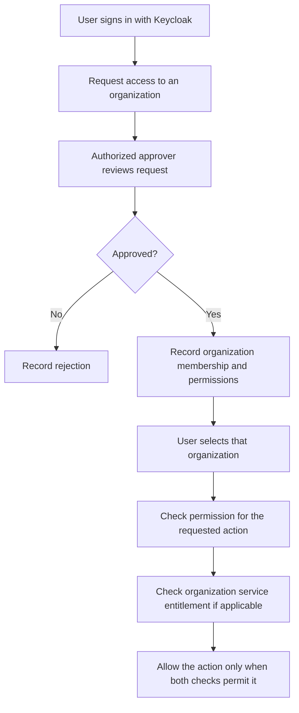
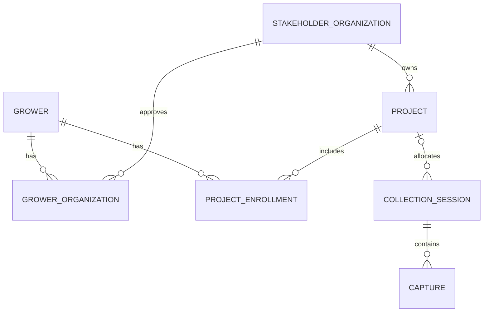
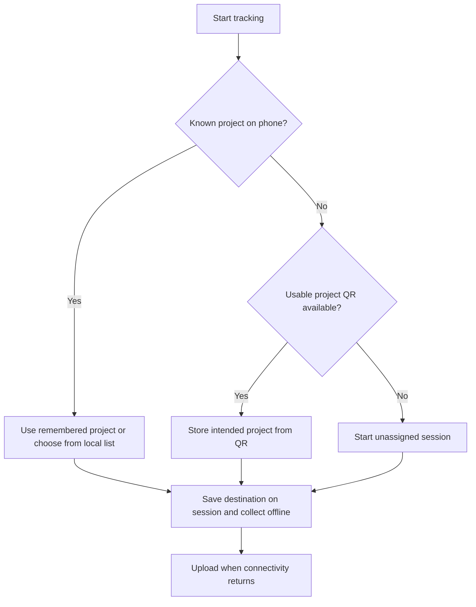
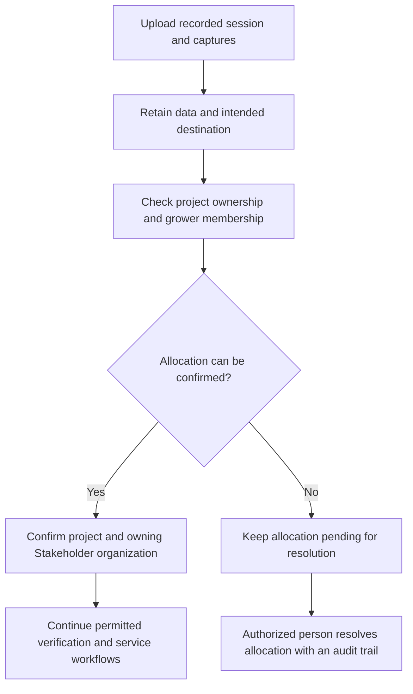

# Organization access, subscriptions and project-based collection

* Status: proposed
* Deciders: To be confirmed with the Stakeholder, identity/admin, Android, Field Data and SaaS maintainers.
* Date: 2026-11-24

Requested by Sebastian Gaertner. Related work: [admin integration #1314](https://github.com/Greenstand/treetracker-admin-client/issues/1314) and [remaining NDM work #1316](https://github.com/Greenstand/treetracker-admin-client/issues/1316).

> **This is the proposed design, not a description of a completed rollout.** The tables below distinguish existing behavior from changes still needed. Free/trial allowances and several approval rules remain open.

## Context and Problem Statement

“Organization binding” currently describes several different things. An admin-panel user requests access, a grower joins an organization, a QR code opens the Android app, and Stripe links a subscription to an organization. We need to connect these flows without treating them as the same relationship.

The **new domain model (NDM)** identifies an organization through its **Stakeholder UUID**. Older integrations still use a numeric organization ID or an organization name. A **session** is one period of field collection; its captures must keep the organization and project they were collected for, even if the grower moves to another organization at a later stage.

### Four separate questions

| Concept | Question it answers | Proposed source |
| --- | --- | --- |
| Login | Who is this person? | Keycloak |
| Membership and permissions | Which organizations can they work with, and what can they do? | Organization-scoped domain memberships |
| Subscription | Which services and limits has the organization purchased? | Stripe, linked to the Stakeholder UUID |
| Data ownership | Which organization and project was this session collected for? | Confirmed session allocation to a project and its owning Stakeholder organization; unresolved sessions remain pending |

**Payment does not make someone an administrator. A QR code does not grant admin access. A grower's current organization does not determine ownership of historical captures.**

## Decision Drivers

* Let a grower work for several organizations and projects with one grower account.
* Keep login access, permissions, billing and data ownership separate.
* Make organization setup simple, including a usable first project.
* Keep collection simple and usable offline, including project switching without a server connection.
* Support older app versions during migration.
* Preserve historical ownership and record administrative corrections.

## Considered Options

| Option | Benefit | Problem |
| --- | --- | --- |
| 1. Use one organization attribute for everything | Smallest change to existing clients | Cannot represent several memberships safely; moving a person can change the meaning of old data |
| 2. Assign sessions only to organizations | Supports collection for several organizations | Does not identify which project or project species list applies |
| **3. Separate memberships and billing; record the session destination and confirm allocation after upload** | Explicit permissions and stable collection ownership | Requires coordinated Android and backend changes |

## Decision Outcome

**Proposed choice: Option 3**, with a default project and a staged migration for older clients. **Collection must remain possible offline.** A session records its intended project when known; missing or unconfirmed allocation must not prevent recording captures.

### 1. Starting an organization

Allow an organization to register and complete setup before buying a subscription. Platform approval establishes its first administrator. Approved setup creates one **General** project so the organization does not need to design a project structure immediately.

The General project:

* Belongs to the organization's Stakeholder UUID and counts toward its project quota.
* Is created only once, including when setup is retried.
* Can be renamed without changing its UUID.
* Starts with an empty species selection, like other new projects. An authorized user can allocate species or explicitly choose organization/default inheritance.

Creating a project does not itself grant paid service access. Local recording and accepting an upload for safekeeping are separate from authorizing organization access, verification, payments or other services. **A three-month trial with up to 500 captures is proposed; free/trial service access and quota rules still need agreement.** Replacing or archiving the default project also needs an agreed rule; it must not change historical session references.

### 2. Giving people admin-panel access

There are two different approval paths:

| Request | Proposed outcome |
| --- | --- |
| First administrator for a new organization | Platform-approved administrator membership, after organization/ownership review |
| Additional user joining an existing organization | Approved membership with explicit permissions, such as verification, project management or species management |

An approved organization administrator can invite and manage later members. We still need to decide whether that administrator can also approve ordinary binding requests, or whether platform approval remains required.

Keycloak remains responsible for login. Domain membership records the organization and permissions; Keycloak roles or claims can reflect that membership. One mutable `organization_id` claim must not be the only record of several memberships.

The existing `org-admin-saas` role is a compatibility mechanism. In the target design, administration is scoped to a particular organization. Being an administrator of organization A must not make someone an administrator of organization B. Billing management may need its own permission.

### 3. Keeping subscriptions separate

A subscription belongs to the organization, not to the email address of one administrator. Stripe metadata should link it to the Stakeholder UUID. Numeric IDs may remain as explicit compatibility mappings during migration.

| Change | What it may affect | What it must preserve |
| --- | --- | --- |
| Upgrade or downgrade | Agreed service limits and features | Memberships and existing data ownership |
| Payment failure or cancellation | Agreed restrictions or grace period | Login identity, memberships and historical sessions/captures |
| New organization administrator | Who can manage the organization or billing | The organization's subscription identity |

The backend must enforce the agreed service policy. A plan label, usage warning or `subscriber_*` role alone is insufficient. Exact free access, trial duration, grace periods and read-only restrictions remain open decisions.

### 4. Growers, organizations and projects

A grower account is distinct from an admin-panel login. A grower may belong to several organizations and participate in several projects. Each project belongs to exactly one Stakeholder organization.

A session may have no confirmed project until its allocation is resolved. This is a relationship diagram, not a proposal to rename existing tables. The existing `treetracker.grower_account_org` relationship already supports several organization associations; project enrollment uses the proposed `stakeholder.project_grower` relationship.

**Example:** Asha works on ESEA's nursery project on Monday and another organization's restoration project on Tuesday. She keeps one grower account. The two sessions belong to their respective projects and organizations.

A grower's home/primary organization may remain useful for contact or reporting. Changing it must not move Monday's captures to Tuesday's organization.

### 5. Simple project selection, fully offline

The start screen shows the collection destination without exposing Stakeholder terminology, UUIDs or membership administration:

> **Collecting for:** ESEA · Nursery
>
> **Change**
>
> **Start tracking**

With one available project, select it automatically and show its name. With several, remember the last choice **for that grower**, rather than sharing one device-wide choice across all growers. Change opens a short local list; it must not require a server request before a session can start.

| Situation | Offline behavior |
| --- | --- |
| Project already stored on the phone | Select it and start immediately |
| A new project is supplied by a usable project QR | Store its identifiers and names locally; record the intended destination as awaiting confirmation |
| No known project and no usable QR | Allow an unassigned session, to be allocated after upload; do not guess ownership |

Switching collection project ends the current session and starts another. It does not change earlier sessions or captures. The selected destination is saved on the session so it survives app restarts and later project changes.

#### What Android needs

| Change | Purpose |
| --- | --- |
| Local project directory | Cache project UUID, owning Stakeholder UUID, names and last-known availability for the grower |
| Small project choice in session setup | Use the remembered/default project with a simple Change action |
| Destination saved on each session | Keep intended IDs and display names even when the grower or device switches projects later; allow missing IDs for unassigned sessions |
| Destination in the upload bundle | Carry stable identifiers and whether the allocation still needs confirmation, rather than relying only on an organization name |
| Background synchronization | Refresh memberships, projects and settings when online; a successful refresh is not required before every session |
| Local collection settings | Cache project species selections, local names and other required settings before fieldwork |

Android receives only the grower's available organizations/projects, rather than the global catalogue. Membership approval and project discovery need a defined backend contract; the phone's cached list or QR is not proof of current permission.

A QR cannot download a large species catalogue offline. If a new project's settings are missing, provide an agreed minimal collection mode, for example leaving species identification for later verification, without claiming that the cached catalogue is the project's approved selection.

### 6. Confirming allocation after upload

**Receiving data for safekeeping is different from approving membership, ownership or verification.** Preserve the session's recorded destination and confirmation state separately from confirmed allocation. Unknown or untrusted destination IDs must not become confirmed ownership just because they were scanned or uploaded.

* The backend derives the owning Stakeholder organization from the project. Conflicting project/organization information remains unresolved rather than being guessed or silently rerouted.
* A pending or revoked membership, a closed project or missing allocation must not cause captures to be discarded. Retaining an upload does not grant the requester access to an organization's data or paid services.
* Offline phones cannot immediately know that membership was revoked, a subscription expired or a quota was reached. Reconcile these changes at synchronization; do not make live authorization or billing checks a prerequisite for every field session. The resulting restrictions and resolution process still need an agreed policy.
* Once allocation is confirmed, capture context follows the session and its project; every table does not need another copied project field. Moving a grower must not move historical data.
* Upload retries must not overwrite an audited administrator correction.
* Correcting allocation requires the real actor, time, reason and previous/new values. Already verified captures, matching events, exports and usage must be reconciled consistently.

### 7. QR codes and older clients

The Share App QR identifies an invitation or collection destination for an organization, optionally a project. It does not create admin permissions or establish approved grower membership. The server applies those rules when connectivity is available.

For offline use, the QR must carry enough project/organization identifiers and display information to record the destination locally, or refer to information already cached on the phone. **A URL containing only an unknown server-resolved token is not enough offline.** Such a token may remain useful for online invitations. The exact QR format and trust/expiry rules remain to be agreed.

This assumes Treetracker is already installed. A phone without the app cannot download it without connectivity.

Move toward Stakeholder UUIDs while retaining numeric `org_id` compatibility for existing Android/install-referrer links. Renaming the parameter alone does not migrate the flow.

Add the new project-aware upload contract only after Android and the ingestion services support it. Do not add a universal non-null project requirement: older clients and intentionally unassigned offline sessions must remain uploadable.

| Available information | Proposed handling |
| --- | --- |
| Known organization and an explicitly configured default project | A controlled migration may allocate the session to that project and record how it was assigned |
| Missing or ambiguous organization/project | Retain for explicit allocation; do not invent ownership |
| Grower belongs to several projects | Do not choose an arbitrary project from their memberships |

Preserve existing UUIDs and historical references. Numeric mappings should resolve to `stakeholder.stakeholder.id`; they do not justify new ownership writes to `public.entity`.

## What exists today and what still needs work

| Area | Current evidence | Remaining change |
| --- | --- | --- |
| Admin binding | Approval sets numeric Keycloak `organization_id`, grants `org` and clears the request. A second organization request is blocked for an already-bound login | Audited NDM memberships, multiple approved admin memberships and explicit first-admin onboarding |
| Member permissions | The integration treats `org-admin-saas` as admin; ordinary `org` members default to verification unless scoped grants override it | Agree and implement the full membership-scoped authorization model |
| Billing | Tier display, hosted billing and usage warnings exist in the integration | Define and enforce free/trial/paid access and quota policies |
| Grower memberships | Existing NDM association supports several organizations | Complete the grower enrollment and Android discovery experience |
| Projects | Proposed project schema and admin assignment/correction workflows exist | Automatic General-project creation and agreed default replacement rules |
| Session uploads | Android stores sessions locally and builds upload bundles, currently carrying an organization string rather than a project UUID | Local project cache/selection, session destination fields, project-aware bundles and ingestion, and pending allocation without data loss |
| QR invitations | Current links forward `org_id` and `org_name` into Android; a minimal organization can be saved locally | Offline-readable project destinations, Stakeholder-based resolution and later membership confirmation |

## Decisions still needed before acceptance

| Topic | Question to settle |
| --- | --- |
| Free/trial access | A three-month trial with up to 500 captures is proposed. What services does it include, how are captures counted, and what happens when the trial ends? |
| Payment and quota changes | Which downstream services are restricted, and how is retained offline data resolved without discarding it? |
| Approvals and recovery | Who verifies the first administrator, approves later members and recovers lost administration access? |
| Invitations | What is the offline-readable QR format, and how do trust, acceptance, expiry and project restrictions work? |
| Android identity and offline use | How are memberships/projects discovered and refreshed per grower, and how are collectors recording for another grower handled? |
| Minimal collection and pending allocation | Which settings may be omitted offline, who resolves unassigned/unconfirmed sessions, and how is pending upload storage managed? |
| Default projects and old data | How is a default replaced, and which legacy sessions may be assigned automatically? |
| Allocation corrections | Who may move sessions across organizations, and how are processed records reconciled? |

## Consequences

**Benefits:** simple offline collection and project switching, clearer permissions, one grower identity across organizations, stable historical ownership and a usable first project.

**Costs:** coordinated changes across Android, Stakeholder, identity/admin and Field Data; local project/settings caching, pending-allocation handling; and a staged migration for older clients. Existing UI or schema PRs alone do not complete this design.

## Links and supporting evidence

### Existing decisions and use cases

* [0013: Keycloak](0013-keycloak.md) and [0014: permission organization](0014-treetracker-permission-organization.md). This proposal refines membership and ownership; it does not unilaterally supersede those proposals.
* [Admin binding scenario #1266](https://github.com/Greenstand/treetracker-admin-client/issues/1266): an admin-panel user requests membership and receives Verify access after approval.
* [Subscription scenario #1261](https://github.com/Greenstand/treetracker-admin-client/issues/1261): an existing organization upgrades to premium.
* [Accepted session-organization bridge ADR, March 2022](https://github.com/Greenstand/treetracker-field-data/blob/main/docs/adr/0001-organization-by-session-bridge.md): explicitly anticipates growers collecting for several organizations. It describes a historical bridge, not a completed current rollout.
* [Grower organization association](https://github.com/Greenstand/treetracker-api/blob/main/database/migrations/sqls/20220321204145-grower-account-organization-up.sql).
* [Android local organization handling](https://github.com/Greenstand/treetracker-android/blob/master/app/src/main/java/org/greenstand/android/TreeTracker/models/organization/OrgRepo.kt), [session creation and recovery](https://github.com/Greenstand/treetracker-android/blob/master/app/src/main/java/org/greenstand/android/TreeTracker/models/SessionTracker.kt) and [session bundle uploader](https://github.com/Greenstand/treetracker-android/blob/master/app/src/main/java/org/greenstand/android/TreeTracker/models/SessionUploader.kt) provide the existing offline foundation.
* [Android SessionRequest](https://github.com/Greenstand/treetracker-android/blob/master/app/src/main/java/org/greenstand/android/TreeTracker/api/models/requests/SessionRequest.kt) and [Field Data session schema](https://github.com/Greenstand/treetracker-field-data/blob/main/server/handlers/sessionHandler/schemas.js).

### Related implementation proposals

* [Admin client #1315](https://github.com/Greenstand/treetracker-admin-client/pull/1315) and [admin API #699](https://github.com/Greenstand/treetracker-admin-api/pull/699).
* [Stakeholder projects and membership #49](https://github.com/Greenstand/treetracker-stakeholder-api/pull/49).
* [Field Data session project #121](https://github.com/Greenstand/treetracker-field-data/pull/121) and [correction audit #122](https://github.com/Greenstand/treetracker-field-data/pull/122).
* [Grower transfer history #165](https://github.com/Greenstand/treetracker-api/pull/165).
