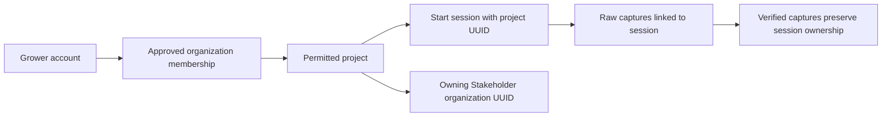

# Separate organization membership, subscription and project-based session ownership

* Status: proposed
* Deciders: To be confirmed: maintainers responsible for Stakeholder, identity/admin, Android, Field Data and SaaS. This proposal records the design discussion requested by Sebastian Gaertner; it does not claim their approval.
* Date: 2026-11-23

Technical Story: [Admin integration #1314](https://github.com/Greenstand/treetracker-admin-client/issues/1314), [remaining NDM migration and BDD work #1316](https://github.com/Greenstand/treetracker-admin-client/issues/1316).

## Context and Problem Statement

Treetracker currently combines several meanings of “organization binding”: an admin-panel login requesting access, a grower collecting for an organization, a mobile invite carrying organization information, and subscription metadata linking a billing customer. These are related but distinct relationships. Treating one mutable Keycloak organization attribute or a grower's home organization as the owner of all subsequent data cannot safely represent multiple memberships or preserve historical ownership.

The new domain model (NDM) uses Stakeholder UUIDs for organizations, project membership for fieldwork, and sessions/captures in Field Data and Treetracker. Existing clients still carry numeric organization IDs or organization strings. We need one explicit lifecycle across registration, access approval, billing, project selection and capture routing, with a compatible migration path.

### Evidence and current implementation, not a completed architecture

* The original [admin binding scenario #1266](https://github.com/Greenstand/treetracker-admin-client/issues/1266) describes a registered admin-panel user requesting an organization, platform approval/rejection and subsequent Verify access.
* The current binding controller sets the numeric Keycloak `organization_id`, grants `org`, and clears the pending attributes. It rejects another request when that login already has an organization. It does not grant `org-admin-saas` or require a subscription; organization lookup still uses the legacy repository. This is not yet an NDM membership/audit transaction.
* The domain-admin integration recognizes `org-admin-saas` as organization administration; ordinary `org` members default to `verify_captures` unless scoped grants override it. First-administrator assignment is not a complete automatic onboarding flow.
* The [subscription scenario #1261](https://github.com/Greenstand/treetracker-admin-client/issues/1261) describes an existing organization upgrading to premium. Paid-tier display, hosted billing and usage warnings exist in the integration; complete access/quota enforcement is not implemented. Subscription status and administrative authority must not be conflated.
* The accepted [March 2022 session-organization bridge ADR](https://github.com/Greenstand/treetracker-field-data/blob/main/docs/adr/0001-organization-by-session-bridge.md) explicitly anticipates a grower tracking for multiple organizations. It describes a historical bridge, not proof that the present end-to-end flow is complete.
* The existing [grower-account organization association](https://github.com/Greenstand/treetracker-api/blob/main/database/migrations/sqls/20220321204145-grower-account-organization-up.sql) supports multiple grower memberships. The project proposal adds `stakeholder.project` and `project_grower`.
* Android's current [SessionRequest](https://github.com/Greenstand/treetracker-android/blob/master/app/src/main/java/org/greenstand/android/TreeTracker/api/models/requests/SessionRequest.kt) contains an organization string but no project UUID. The current [Field Data session POST schema](https://github.com/Greenstand/treetracker-field-data/blob/main/server/handlers/sessionHandler/schemas.js) also does not accept the proposed project input. Admin-side session project correction and a database column do not complete mobile upload support.
* Share App forwards `org_id`/`org_name` into Android deep-link/install-referrer handling. This is an organization invitation/context hint, not proof of admin membership. Scanning the QR must not grant admin-panel access.

## Decision Drivers

* Separate authentication, authorization, commercial entitlements and data ownership.
* Support growers working for multiple organizations and projects without duplicating their identity.
* Resolve all new domain ownership to Stakeholder UUIDs, while migrating existing clients safely.
* Preserve session/capture ownership when people move or subscriptions change.
* Permit offline collection with explicit, validated context and deterministic retry behavior.
* Record real actors, time, reasons and previous values for administrative changes.

## Considered Options

1. Use the single Keycloak organization attribute or grower's current organization for membership and capture ownership.
2. Select an organization for each session, with projects optional indefinitely.
3. Separate memberships and entitlements, and assign each new session to a validated project owned by one Stakeholder organization, with an explicit default-project and legacy-upload transition.

## Decision Outcome

Proposed choice: **Option 3**. The rules below are proposed for review; this ADR is not an implementation-complete or acceptance record.

### 1. Identity and memberships

Keycloak authenticates an admin-panel user. Domain membership records which Stakeholder organizations that user may access and the capabilities granted within each. Keycloak roles/claims may be synchronized projections; a single organization claim must not become the only authoritative multi-organization membership store.

A grower account is a separate domain identity from an admin-panel login. A grower may have approved memberships in several organizations and enrollments in several projects. Being a grower, scanning a QR or paying a subscription grants no administrative privileges. A home/primary organization may remain useful for contact or reporting, but must not overwrite historical collection ownership.

This ADR permits a future admin login with several approved organization memberships. Implementing the organization selector and membership checks for that case is separate from the existing single-claim binding flow.

### 2. Organization onboarding and subscription

An organization may register and complete setup without an active paid subscription. Record onboarding/approval state independently of subscription state. This does **not** establish free production quotas, wallet access, unlimited uploads or a trial duration: those entitlements require the policy decisions below.

Subscription status controls the organization's agreed service entitlements, not who its administrators are. Stripe metadata must resolve to the canonical Stakeholder organization UUID, retaining numeric metadata only as an explicit compatibility mapping. Do not use an email address as the stable organization identifier.

Cancellation, payment failure or plan changes must not delete membership, historical sessions/captures or identity login access. The precise restricted/read-only behavior and any payment-recovery grace period remain open policy decisions. The backend must enforce the agreed policy; UI warnings and `subscriber_*` roles alone are insufficient.

### 3. Assigning the first and subsequent organization administrators

Establish the first administrator through a platform-approved organization onboarding/ownership verification action. Record who approved it and the scope granted. Do not make every approved binding applicant an organization administrator, and do not infer administration rights from a paid plan or matching email.

An authorized organization administrator may then invite/manage additional members and grant agreed capabilities such as verification, projects, species or membership management. Platform administrators retain an audited recovery path. Whether ordinary binding approvals may be delegated to organization administrators must be agreed before enabling that delegation.

The present `org-admin-saas` role is a compatibility mechanism; the target authorization is membership-scoped. Billing administration may also need a distinct capability. The migration must avoid a global role accidentally granting administration in every organization a person joins.

### 4. A default project

Create one idempotent **General** project during approved organization setup, owned by that Stakeholder UUID. It counts toward the plan's project allowance; it is not an extra unmetered project. Its display name may be edited while its UUID remains stable.

The project exists to avoid forcing a new organization to design a project structure before collecting. An organization may later choose a different default. Archiving or replacing the default requires an explicit replacement rule and must not change historical references.

Default project selection and species inheritance are separate settings. Preserve the current rule that new project species selections start explicitly empty; an authorized user can allocate species or explicitly restore organization/default inheritance. Do not silently select the entire species catalogue because the project is called General.

### 5. Project-based session and capture routing

Each project belongs to exactly one Stakeholder organization. Once supported by the mobile/upload contract, every **new** session starts with one authorized project UUID. The backend resolves its owning organization and validates grower eligibility. It must reject conflicting client-supplied organization/project pairs rather than trusting a name, QR parameter or device preference.

Capture organization/project context is derived from the session and project relationship; this does not require copying a project column into every table. Do not route captures through the grower's current/home organization. Switching collection project starts a new session.

An authorized correction to session allocation requires a reason, real actor, timestamp and previous/new context. Define reconciliation for already verified captures, matching events, exports and usage before applying a correction; changing only the session must not leave downstream ownership inconsistent. Moving a grower does not move historical data.

### 6. Android, offline behavior and QR invitations

Android receives and caches only the approved organizations/projects available to the grower, rather than a global project catalogue. Before collection it selects organization/project explicitly, or uses the sole permitted/default project with a visible indication. The session retains that selection during offline collection and uploads the project UUID through a versioned, validated contract.

QR/deep links should resolve to a Stakeholder organization invitation, optionally narrowed to a project. Resolve opaque invitation tokens or validated identifiers on the server; the link itself is not an authorization credential unless a separately reviewed invitation design says so. Retain numeric `org_id` compatibility during the Android/install-referrer transition. Renaming the parameter alone does not complete the migration.

Upload retries must be idempotent and must not overwrite an audited administrator correction. Membership revoked while a device was offline needs an explicit server policy; do not silently route those captures to a different organization.

### 7. Legacy transition and historical data

Require project UUIDs for new clients only after Android and the upload API support them. Older sessions and records with missing organization/project remain representable; do not fabricate assignments to satisfy a new constraint.

A controlled migration may allocate an unambiguous legacy session to its known organization's configured default project, with provenance. If organization or project ownership is ambiguous, retain it for explicit allocation/reconciliation instead of guessing. Never select an arbitrary project just because the grower belongs to several projects.

Numeric Keycloak/mobile mappings resolve to `stakeholder.stakeholder.id`; they do not justify new `public.entity` ownership writes. Preserve capture/session UUIDs, historical references and reviewed ownership through the transition.

### Open policy and contract decisions before acceptance

* Unsubscribed/free/trial service allowances, duration, approval and upgrade requirements.
* Quota exhaustion, cancellation/payment recovery and offline-upload behavior; whether previously collected data is accepted, held or restricted must be explicit.
* Who verifies the first administrator, invitation expiry/acceptance, recovery and whether organizations approve their own ordinary membership requests.
* Precise Android authorization/bootstrap and membership/project discovery API, including collectors recording for another grower and offline revocation handling.
* Default-project replacement/archive behavior and the reviewed legacy backfill procedure.
* Cross-organization session corrections and reconciliation of already processed data, billing counts and matching events.

These are not resolved merely by merging the existing UI, schema or billing integration PRs.

### Positive Consequences

* Membership, payment and data ownership can evolve independently without accidental privilege escalation.
* Multi-organization growers have an explicit collection context and retain one grower identity.
* New organizations have a usable initial project, while historical data remains attributable.
* UI, Android, services and BDDs can share one reviewable contract.

### Negative Consequences

* Requires coordinated Android, Stakeholder, identity/admin and Field Data service changes.
* Offline caching, membership validation and downstream correction reconciliation add work.
* Legacy clients need a staged migration; a universal non-null project constraint cannot be enabled immediately.

## Pros and Cons of the Options

### Option 1: One mutable organization attribute

Simple for existing clients, but cannot express independent memberships and rewrites ownership semantics when a person moves. Rejected as the target model.

### Option 2: Organization-only sessions

Supports multi-organization collection with fewer client changes, but cannot reliably identify a project when a grower has several enrollments or apply project-specific species/settings. Useful only as an explicit compatibility stage.

### Option 3: Independent membership and project-owned sessions

Supports the required organization/project boundaries and auditability. More implementation work, addressed through a default project and staged client migration.

## Implementation and acceptance evidence required

* Membership onboarding/approval/rejection, least privilege and first-admin assignment tests.
* Separate admin binding and grower QR enrollment scenarios; neither must silently perform the other.
* Tests for two organizations and multiple projects, including one grower participating in both.
* Tests that missing/expired subscriptions never change historical ownership or grant administrator roles; enforce the agreed entitlements separately.
* Idempotent General-project creation, quota accounting, explicit empty species selection and controlled default replacement tests.
* Android offline project selection, validated upload, ambiguous legacy upload, revoked membership and correction-safe retry tests.
* Audited project/organization correction with downstream consistency and unchanged historical data on grower transfer.

Add/refine the existing [domain BDD catalogue](https://github.com/SebastianGaertnersAI/treetracker-admin-client/tree/feat/domain-admin-views/features/domain) against the accepted rules. Its current manual specifications and linked unit tests do not establish that this cross-service proposal has been implemented end to end. Implementation work is tracked in #1316 above; no DB or Keycloak change is authorized by this document itself.

## Links

* Related identity proposals: [0013 Keycloak](0013-keycloak.md), [0014 permission organization](0014-treetracker-permission-organization.md). This proposal refines membership/ownership boundaries; it does not unilaterally supersede them.
* Historical routing decision: [Field Data session organization bridge](https://github.com/Greenstand/treetracker-field-data/blob/main/docs/adr/0001-organization-by-session-bridge.md).
* Existing UI/API integration: [admin client #1315](https://github.com/Greenstand/treetracker-admin-client/pull/1315), [admin API #699](https://github.com/Greenstand/treetracker-admin-api/pull/699).
* Proposed project membership: [Stakeholder #49](https://github.com/Greenstand/treetracker-stakeholder-api/pull/49).
* Proposed session project field and correction audit: [Field Data #121](https://github.com/Greenstand/treetracker-field-data/pull/121), [#122](https://github.com/Greenstand/treetracker-field-data/pull/122).
* Proposed grower transfer history: [Treetracker API #165](https://github.com/Greenstand/treetracker-api/pull/165).
